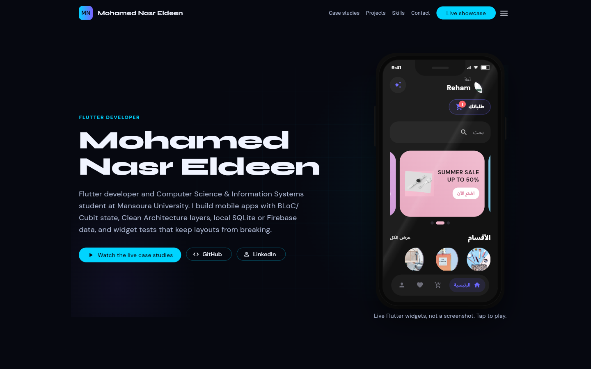
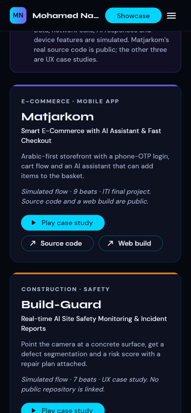
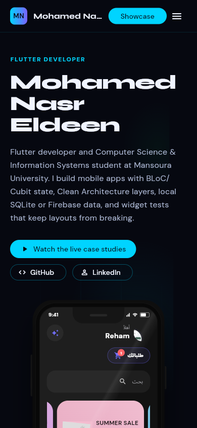

# Mohamed Nasr Eldeen — Flutter Developer

[VERIFIED] A Flutter web portfolio with an introduction, skills, public-source projects, interactive case studies, architecture notes, experience, education and contact links. Evidence: `lib/portfolio/portfolio_page.dart:86`.

[VERIFIED] The case studies are live widget trees, not screenshots. Their data, network calls, AI responses and device features are simulated. The landing page and player both disclose this. Evidence: `lib/portfolio/portfolio_page.dart:632`, `lib/showcase/shell.dart:665`.

[VERIFIED] Matjarkom has public source at https://github.com/Mo-Nasr-Eldeen/ITI-Final-Project and a reachable web build at https://iti-final-project-w77f.vercel.app/. The source descriptions follow its README; its backend was not exercised here. Evidence: `lib/portfolio/profile_data.dart` and `PROJECT_STATUS.md`.

[UNVERIFIED] Build-Guard, Brew & Bloom and TrustSafe do not have verified public app repositories or backend integrations. They are presented as UX case studies, not production apps.

## Visual previews

[VERIFIED] Captured from the local release build in Edge at desktop and mobile viewports on 2026-11-13.





## Run and build

[VERIFIED] Local validation used Flutter 3.47.9 / Dart 3.13.7. Commands below ran successfully on 2026-11-13; the release output is `build/web`.

```sh
flutter pub get
flutter run -d chrome
flutter analyze
flutter test
flutter build web --release
```

[VERIFIED] The root route opens the portfolio. These hash routes open the player directly and preserve a portfolio page beneath it for back navigation. Evidence: `lib/main.dart:9`, `lib/showcase/showcase_page.dart`.

```text
/#/showcase
/#/showcase?demo=matjarkom
/#/showcase?demo=build_guard
/#/showcase?demo=brew_and_bloom
/#/showcase?demo=trustsafe
```

## Player controls

[VERIFIED] Keyboard bindings and on-screen touch controls are implemented in `lib/showcase/shell.dart:35`; tests are in `test/shell_test.dart`.

| Key | Action |
| --- | --- |
| `→` / `D` | Next beat |
| `←` / `A` | Previous beat |
| `Shift` + `→` / `←` | Next / previous project |
| `Space` | Play / pause |
| `S` | Cycle playback speed |
| `N` | Speaker notes |
| `M` | Captions |
| `R` | Restart current project |
| `1`–`4` | Jump to a project |

[VERIFIED] The tour contains 28 beats. Source: `lib/showcase/demos.dart`.

| Case study | Beats | Simulated flow |
| --- | --- | --- |
| Matjarkom | 9 | Arabic storefront, login, cart, checkout and assistant |
| Build-Guard | 7 | Camera, capture, analysis, risk result and repair plan |
| Brew & Bloom | 6 | Onboarding, catalogue, customisation, order, tracking and rewards |
| TrustSafe | 6 | Login, vault, document upload, permissions, unlock and settings |

## Architecture

[VERIFIED] Existing player architecture and theme are retained; external links use `url_launcher` and emit web anchors. Evidence: `lib/portfolio/portfolio_page.dart:410`.

```text
lib/main.dart                  MaterialApp and route creation
lib/portfolio/profile_data.dart Profile and public project descriptions
lib/portfolio/portfolio_page.dart Responsive landing page
lib/showcase/                  Timeline, shell, theme and phone frame
lib/demos/                     Self-contained case study widgets
assets/fonts/                  Syne, DM Sans and Arabic fallback fonts
web/                           Metadata, loading fallback and sharing artwork
test/                          Timeline, rendering and portfolio gates
tool/vercel_build.sh           Format → analyze → test → web build
```

[VERIFIED] The new landing page uses a higher-contrast body colour; tests enforce 4.5:1 contrast for the checked foreground/background combinations. This is not a claim of a complete accessibility audit. Evidence: `test/portfolio_test.dart`.

[VERIFIED] CanvasKit font preparation tools exist at `tool/prepare_fonts.py` and `tool/check_fonts.py`; the current fonts are bundled rather than loaded from a third-party font CDN.

## Verification

[VERIFIED] Latest full run: 87 tests passed, analyzer reported no issues, release web build passed. The new tests check responsive layouts, external-link allowlist, simulation notice, selected-case navigation, deep links, clipboard feedback, metadata, sharing artwork and build configuration. Evidence: `test/portfolio_test.dart` and `PROJECT_STATUS.md`.

[VERIFIED] Browser checks exercised all four card-to-player flows, all 28 tour beats, keyboard switching/playback, back navigation, a mobile TrustSafe deep link, the section menu and contact navigation. No runtime exceptions or error-console messages were observed in that run.

[UNVERIFIED] Android build/device execution, real backend flows, performance budgets, full accessibility auditing and Vercel cloud execution were not verified in this session.

## Deployment

[VERIFIED] `vercel.json` now invokes `bash tool/vercel_build.sh` before serving `build/web`, with an SPA rewrite. The script stops on failed formatting, analysis, tests or build. Its locally installed SDK path passed all gates.

[UNVERIFIED] The cloud SDK-bootstrap branch pins Flutter 3.47.9 but has not run on Vercel. Cloud resource limits and deployment protection were not tested.

[VERIFIED] The existing production URL https://portfolioliveshowcase.vercel.app/ was reachable during discovery. These local changes have not been published; see `PROJECT_STATUS.md` for current publication status.

[NEEDS MY DECISION] Authorize branch push and preview/production deployment separately. A public repository alone does not authorize publication. After authorization, deploy the source through Vercel and verify the returned URL before promoting it.

## Audit and roadmap

[VERIFIED] `PORTFOLIO.md` records workspace discovery and priorities. `PROJECT_STATUS.md` records evidence, completed changes, test results, unverified items and remaining decisions.
